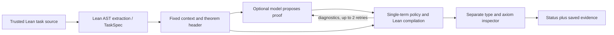

# Architecture

The same TaskSpec renders the generation prompt and the candidate Lean file. The prefix before the target is retained, including namespaces, sections, variables and intermediate definitions. The reference proof and following declarations do not enter the prompt. Extraction uses Lean syntax nodes rather than splitting on the first `:=`.

`core.py` owns TaskSpec, tool discovery, restricted processes, statuses and evidence. `LeanTool.lean` parses source/terms, compiles modules and inspects types/axioms. `pipeline.py` handles optional MLX generation and repair. `cli.py` supplies a model-free entry point and explicitly configured model paths. `selftest.py` exercises both valid and deliberately invalid cases.

Compilation can emit arbitrary diagnostics; none of these messages can assert an axiom audit. The trusted inspector writes a separate structured artifact after loading the compiled module. It checks theorem kind, definitional equality of the type and transitive axiom dependencies. Only then can the Python policy consider strict acceptance.

Allowed standard axioms are `propext`, `Classical.choice`, `Quot.sound`. Additional axioms lead to a conditional result. A successful theorem on standard axioms is not necessarily axiom-free. `sorryAx` is rejected, including transitive dependency on it. Warnings are recorded separately and prevent strict acceptance.

## Scope of evidence

Every attempt is a new UUID directory. Result hashes cover its saved files. A separate seal hashes the result itself; `replay` checks both. These are local integrity records, not signed attestations. The inspector's source digest and Lean version are saved with each result. Full imported dependency hashing, toolchain binary attestation, external timestamping and complete supply-chain locking remain future work.

## Model independence

The verifier can be used without MLX or a model. The generator currently targets MLX-compatible local models; no remote provider is required. The model manifest records the selected model and adapter file hashes. First-attempt success and success after feedback are separate metrics. Old examples are regression cases, not an independent model benchmark.
